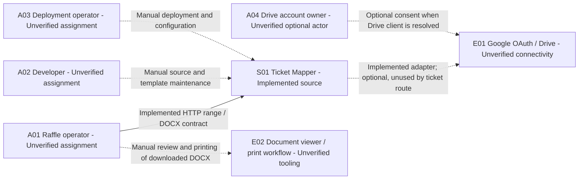

# Architecture model: entry point for Wally / Lenscape

[Context index](../index.md) · [Implementation overview](architecture.md)

This is a source-grounded, tool-neutral model of Ticket Mapper, from actors to
runtime components. It is intended to let Wally reconstruct the application's
architecture in Lenscape without guessing relationships. No Lenscape schema,
importer, or Wally-specific instructions have been supplied or tested. This is
documentation input, not a claim of a successful Lenscape import.

The implementation baseline remains `5cfca982c59cd3afd3c0101a0dcc0b257a57a297` on
`origin/dev`. These views describe source behavior; the missing-project build
blocker in [known issues](known-issues.md) still applies.

## Model hierarchy and reading order

| Level | Canonical view | Contents |
| --- | --- | --- |
| People and goals | [Actors and use cases](actors-and-use-cases.md) | Human responsibilities, supported interactions, manual tasks, preconditions and outcomes. |
| System context | This document | Ticket Mapper boundary and adjacent actors/systems. |
| Runtime and deployment | [Runtime view](runtime-view.md) | API process, Compose scaffold, ports, storage, configuration and trust boundaries. |
| Components and contracts | [Component map](component-map.md) | Classes, interfaces, DI bindings, lifetimes and dependency relationships. |
| Dynamic behavior | [Sequence flows](sequence-flows.md) | Success, generation/read failure, cancellation and cleanup. |
| Evidence and completeness | [Traceability](architecture-traceability.md) | Actor → use case → route → components → resource → source → verification. |

These are context/container/component-style views. Here a **runtime** is a process
or separately deployable service; a .NET project or handler is not a microservice.
The main system is `S01`, containing API runtime `R01`, whose components are
`C01`–`C14`; `C15` is repository-only scaffold. Optional broker scaffold `R02` is
separately deployed by Compose.
Human actors (`A`), external systems (`E`), resources (`D`), and use cases (`UC`)
have stable IDs across all views. Preserve IDs when renaming labels.

## Status vocabulary

| Status | Meaning |
| --- | --- |
| **Implemented** | Present in tracked executable code or deployment configuration. Does not mean compiled, tested, deployed, reachable, or secure. |
| **Placeholder** | Named scaffold/interface/class exists but does not implement its claimed business capability. |
| **Proposed** | Recommended future design; no implementation in the baseline. Keep outside current-state diagrams. |
| **Unverified** | Runtime/organizational/external fact not established by repository evidence. |

Status and participation are separate: an **Implemented** adapter can be **optional**
and unused by the active ticket path. Human personas below are inferred operational
responsibilities, marked **Unverified** for actual assignment, not app-defined roles.
Edges also carry status/participation: solid arrows show implemented source paths;
dashed arrows show optional or manual interactions and explicitly named unknowns.
No line represents a proven live connection.

## System context

| ID | Element / status | Boundary and evidence |
| --- | --- | --- |
| S01 | Ticket Mapper / Implemented | Web API and in-process generation/cleanup. [Program](../../src/TicketMapper.WebApi/Program.cs), [controller](../../src/TicketMapper.WebApi/Controllers/DocumentController.cs). |
| E01 | Google OAuth and Drive / Unverified connectivity | External account/service. Adapter and credential loader exist; no live grant or call verified. [Drive setup](../../src/TicketMapper.WebApi/Configs/ConfigureGoogleDrive.cs), [adapter](../../src/TicketMapper.Infrastructure.DocumentService/GoogleDrive.cs). |
| E02 | Document viewer and printing / Unverified tooling | Manual downstream activity inferred from downloadable Word output and original raffle purpose; no viewer/printer integration. [Usage](overview-and-usage.md). |

Swagger/browser/curl are alternative clients of `R01`, not separate business
services. The filesystem belongs to the host/runtime boundary and is expanded in
the runtime view. NuGet and container registries are build dependencies, not
ticket-request participants. RabbitMQ is a deployment scaffold and has no business
edge to generation. There is no frontend application, database, payment service,
customer registry, persistent number allocator, job scheduler or external event bus.

## Rules for reconstructing the model

1. Read the actor catalog, then place `S01`, `R01`, and components within their
   stated parents. Keep projects as source organization, not deployment nodes.
2. Copy status and participation labels with each element and edge. Do not promote
   a configured service to a verified deployment or a manual persona to an RBAC role.
3. Use the component relationship and DI tables for static dependencies; use the
   sequence diagrams for call order. A dependency arrow is not proof of invocation.
4. Keep local read/delete separate from Google Drive operations. The cleanup
   notification is awaited in the same process and is not a RabbitMQ message.
5. Attach the traceability row and source links to each use case. Preserve unknowns
   instead of choosing a cloud provider, production host, owner or security control.
6. Keep proposed controls below in a separate future-state view. Before calling the
   model complete for production, obtain the evidence listed in traceability.

## Future-state elements, excluded from current diagrams

| ID | Proposed capability | Motivation; no implementation implied |
| --- | --- | --- |
| P01 | Authentication / enforced access policy | API currently has no endpoint access requirement. |
| P02 | Bounded requests and concurrency controls | Unbounded ranges and shared PNG filenames. |
| P03 | Per-request workspace and guaranteed cleanup | Failure/cancellation can leave artifacts. |
| P04 | Validated release pipeline and operational monitoring | No tracked CI or verified deployment/observability setup. |

See [security](security.md), [deployment](deployment.md), and
[known issues](known-issues.md) for evidence and follow-up decisions.
