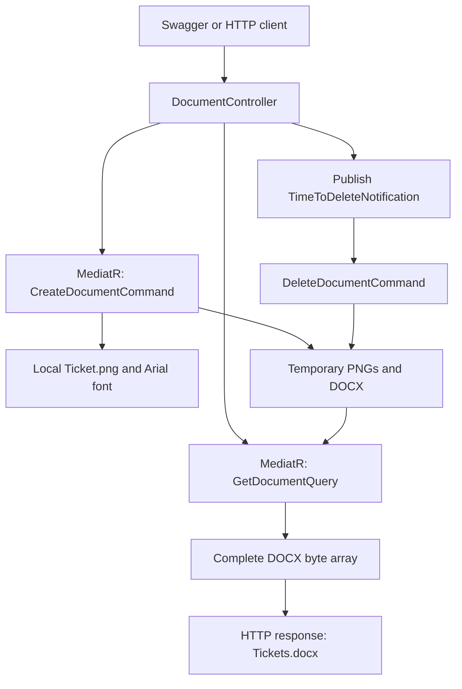

# Architecture

[Context index](../index.md)

## Runtime shape

The application is one ASP.NET Core Web API process with controllers and MediatR
request/notification handlers. Ticket rendering and temporary file I/O execute
inside the HTTP request. There is no background job worker, database, or message
broker in the implemented ticket-generation path.

The controller awaits create, read, and notification publication in that order.
The notification is in-process; `IntegrationEventHandlers` is a folder name, not
evidence of an external event bus. Deletion happens after the read and before the
file response is returned, not after a client acknowledges receipt.

## Source and project map

| Area | Responsibility and current limits |
| --- | --- |
| `TicketMapper.WebApi` | Entry point, controller endpoints, DI, configuration, Swagger, logging, OAuth service registration. |
| `TicketMapper.Application` | Create/read/delete use cases and deletion notification handler. Rendering directly uses ImageSharp, Open XML, and `System.IO`; read/delete use `IFileSystem`. |
| `TicketMapper.Domain` | Ticket and notification models; MediatR command/query interfaces; settings and Drive repository interfaces. No range-validation business rules. |
| `TicketMapper.Infrastructure.DocumentService` | Google Drive upload/download/delete/list/metadata adapter. Source exists, `.csproj` is missing. |
| `TicketMapper.Infrastructure.Persistence` | Empty Drive repository implementation/interface boundary. Source exists, `.csproj` is missing. No database persistence. |
| `TicketMapper.Infrastructure.FileIO` | Empty `Class1` and a project file; not listed in the solution or referenced by WebApi. |
| `TicketMapper.Test.Application` | Tests for read/delete/notification behavior; no generation tests. |
| `TicketMapper.Test.Domain`, `TicketMapper.Test.WebApi` | Empty test bodies; no demonstrated domain or HTTP coverage. |

Declared project dependencies: WebApi → Application, Domain, DocumentService,
Persistence; Application → Domain; Test.Application → Application and Domain.
The other two test projects do not reference production projects. The missing
infrastructure project files prevent verifying their intended package/project graph.

## Startup and dependency injection

[Program.cs](../../src/TicketMapper.WebApi/Program.cs) creates the web builder and a
separate configuration object for app settings and Serilog. It configures logging,
binds settings, registers dependencies, registers Drive, configures MediatR, and
adds controllers and Swagger. Middleware enables Swagger only in Development,
then HTTPS redirection, authorization middleware, and controller mapping.

[ConfigureDependencies](../../src/TicketMapper.WebApi/Configs/ConfigureDependencies.cs)
registers `IGoogleDrive`, `IFileSystem`, `IGoogleDriveRepository`, the deletion
notification handler, and concrete create/read/delete request handlers as transient.
[ConfigureMediatR](../../src/TicketMapper.WebApi/Configs/ConfigureMediatR.cs) scans the
WebApi assembly. Application handlers use interface request types; the explicit
concrete request registrations are therefore important to inspect when refactoring.
Verify actual dispatch through `IMediator`, not only direct handler calls.

[ConfigureGoogleDrive](../../src/TicketMapper.WebApi/Configs/ConfigureGoogleDrive.cs)
registers a singleton `DriveService` with a factory. It blocks on OAuth credential
loading using `.Result` when resolved. Registration alone does not prove that the
Drive OAuth flow runs at startup; neither controller uses the Drive service.

## Error and concurrency boundaries

The controller has separate try/catch blocks for create and read/cleanup. The read
handler rethrows errors; create/delete and the notification handler swallow some
errors after logging. This means transport status, log messages, file existence,
and ticket completeness can disagree. See [API](api.md) for exact responses.

Requests get GUID-based DOCX names but use `ticket_{number}.png` in the same output
directory. The app has no request lock or per-request working directory. Overlapping
requests can overwrite or delete each other's intermediate images. Horizontal
scaling and shared storage have no established coordination design.

## Architecture boundaries to preserve or revisit explicitly

Keep HTTP contracts and composition in WebApi, use-case orchestration in Application,
and external-service adapters in Infrastructure. A future queued generation system,
database, authenticated UI, or Drive-backed ticket store would be a new feature,
not an existing capability. Treat request isolation, error propagation, input bounds,
and guaranteed cleanup as identified future work in [known issues](known-issues.md).

Additional evidence: [solution](../../src/TicketMapper.sln),
[create handler](../../src/TicketMapper.Application/Commands/CreateDocumentCommand.cs),
[read handler](../../src/TicketMapper.Application/Queries/GetDocumentQuery.cs),
[notification handler](../../src/TicketMapper.Application/IntegrationEventHandlers/TimeToDeleteNotificationHandler.cs).
