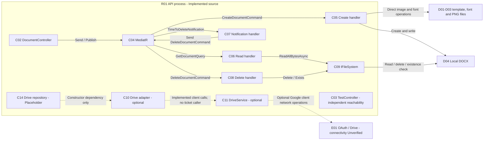

# Components, contracts, and dependency injection

[Architecture model](architecture-model.md) · [Runtime view](runtime-view.md)

## Component catalog

C01–C14 belong to runtime R01 inside S01. C15 is repository-only scaffold outside
the active runtime dependency graph. “Implemented” describes source, not successful
compilation or exercised runtime behavior. MediatR and filesystem components are
libraries in the API process, not remote services.

| ID / status | Component and source | Responsibility / participation |
| --- | --- | --- |
| C01 / Implemented | [Program and composition](../../src/TicketMapper.WebApi/Program.cs) | Startup, registration, middleware, Swagger and host lifecycle. |
| C02 / Implemented | [DocumentController](../../src/TicketMapper.WebApi/Controllers/DocumentController.cs) | Active generation HTTP orchestration; translates some errors to responses. |
| C03 / Implemented | [TestController](../../src/TicketMapper.WebApi/Controllers/TestController.cs) | Reachability endpoint; logs and returns `Hi`. |
| C04 / Implemented | [MediatR registration](../../src/TicketMapper.WebApi/Configs/ConfigureMediatR.cs) | In-process `Send` and `Publish` dispatch; concrete handler bindings also in C01's dependency configuration. |
| C05 / Implemented | [CreateDocumentCommandHandler](../../src/TicketMapper.Application/Commands/CreateDocumentCommand.cs) | Active template/font/image/DOCX rendering; direct file I/O. |
| C06 / Implemented | [GetDocumentQueryHandler](../../src/TicketMapper.Application/Queries/GetDocumentQuery.cs) | Active complete-file read to byte array via C09. |
| C07 / Implemented | [TimeToDeleteNotificationHandler](../../src/TicketMapper.Application/IntegrationEventHandlers/TimeToDeleteNotificationHandler.cs) | Active notification consumer; sends local deletion request. |
| C08 / Implemented | [DeleteDocumentCommandHandler](../../src/TicketMapper.Application/Commands/DeleteDocumentCommand.cs) | Active best-effort local file deletion and existence check via C09. |
| C09 / Implemented | [IFileSystem → FileSystem binding](../../src/TicketMapper.WebApi/Configs/ConfigureDependencies.cs) | Local read/delete abstraction used by C06/C08, not C05. |
| C10 / Implemented, optional | [GoogleDrive](../../src/TicketMapper.Infrastructure.DocumentService/GoogleDrive.cs) | Drive CRUD/metadata/list adapter; no ticket-route caller. |
| C11 / Implemented, optional | [DriveService factory and OAuth loader](../../src/TicketMapper.WebApi/Configs/ConfigureGoogleDrive.cs) | Resolves account credentials and constructs Google client when requested. |
| C12 / Implemented | [Settings binder](../../src/TicketMapper.WebApi/Configs/ConfigureApplicationSettings.cs), [ApplicationSettings](../../src/TicketMapper.WebApi/Settings/ApplicationSettings.cs) | Binds custom configuration; settings object passed during startup, captured by Drive factory. |
| C13 / Implemented | [Serilog configuration](../../src/TicketMapper.WebApi/Configs/ConfigureLogging.cs) | Configures logger from custom configuration; actual active sink unverified. |
| C14 / Placeholder | [GoogleDriveRepository](../../src/TicketMapper.Infrastructure.Persistence/Repositories/GoogleDriveRepository.cs) | Injects C10 but has no business methods; no HTTP caller. |
| C15 / Placeholder | [FileIO Class1](../../src/TicketMapper.Infrastructure.FileIO/Class1.cs) | Empty class; project not in solution or WebApi references. |

## Component relationships

C01 composes this graph; C12 supplies bound settings and C13 configures logging.
They are omitted from the behavioral diagram to avoid implying a request calls
startup repeatedly. C15 has no runtime edge. All solid internal edges are
Implemented; dashed edges are optional or placeholder dependencies as labeled.

## DI binding inventory

Source: [ConfigureDependencies](../../src/TicketMapper.WebApi/Configs/ConfigureDependencies.cs)
and [ConfigureGoogleDrive](../../src/TicketMapper.WebApi/Configs/ConfigureGoogleDrive.cs).

| Registered service | Implementation / component | Lifetime / notes |
| --- | --- | --- |
| `IRequestHandler<CreateDocumentCommand, Unit>` | `CreateDocumentCommand.CreateDocumentCommandHandler` / C05 | Explicit transient. Handler declares the interface request type `ICreateDocumentCommand`. |
| `IRequestHandler<GetDocumentQuery, byte[]>` | `GetDocumentQuery.GetDocumentQueryHandler` / C06 | Explicit transient. Handler declares `IGetDocumentsQuery<byte[]>`. |
| `IRequestHandler<DeleteDocumentCommand, Unit>` | `DeleteDocumentCommand.DeleteDocumentCommandHandler` / C08 | Explicit transient. Handler declares `IDeleteDocumentCommand`. |
| `INotificationHandler<TimeToDeleteNotification>` | `TimeToDeleteNotificationHandler` / C07 | Explicit transient. |
| `IFileSystem` | `FileSystem` / C09 | Explicit transient. |
| `IGoogleDrive` | `GoogleDrive` / C10 | Explicit transient; optional. |
| `IGoogleDriveRepository` | `GoogleDriveRepository` / C14 | Explicit transient; placeholder. |
| `DriveService` | Factory / C11 | Singleton; factory calls async credential loader through `.Result` on resolution. |

`AddMediatR(typeof(Program).Assembly)` scans the WebApi assembly; Application
handlers are explicitly registered above. Check both interface/concrete types when
changing dispatch. `AddControllers` provides framework controller activation;
`ILogger<T>` comes through host logging. Do not invent a scoped repository/unit of
work or singleton handler lifetime. No `IApplicationSettings` service registration
appears here: the constructed settings object is passed to configuration methods;
the dependency method's settings argument is unused.

## Contracts and data crossing components

| Contract / source | Producer → consumer | Meaning |
| --- | --- | --- |
| [TicketDetails](../../src/TicketMapper.Domain/DataModels/TicketDetails.cs) | C02 → C05 | Inclusive integer bounds and server-chosen DOCX path; no validation rules. |
| [ICreateDocumentCommand](../../src/TicketMapper.Domain/Interfaces/Commands/ICreateDocumentCommand.cs) | `CreateDocumentCommand` → C05 via C04 | Request returning `Unit`; no output manifest or completeness result. |
| [IGetDocumentsQuery](../../src/TicketMapper.Domain/Interfaces/Queries/IGetDocumentsQuery.cs) | `GetDocumentQuery` → C06 via C04 | Path in; byte array out. |
| [TimeToDeleteNotification](../../src/TicketMapper.Domain/Notifications/TimeToDelete.cs) | C02 → C07 via C04 | GUID, filename, UTC timestamp; in-memory, not durable. |
| [IDeleteDocumentCommand](../../src/TicketMapper.Domain/Interfaces/Commands/IDeleteDocumentCommand.cs) | C07 → C08 via C04 | Local path; `Unit` does not prove deletion succeeded. |
| [IGoogleDrive](../../src/TicketMapper.Infrastructure.DocumentService/Interfaces/IGoogleDrive.cs) | Optional caller → C10 | Streams/file IDs/metadata for Drive; no caller in current ticket flow. |
| [GoogleDriveFile](../../src/TicketMapper.Infrastructure.DocumentService/Data%20Models/GoogleDriveFile.cs) | C10 → optional caller | External ID/name/MIME metadata; not a local ticket model. |
| [IGoogleDriveRepository](../../src/TicketMapper.Domain/Interfaces/Repositories/IGoogleDriveRepository.cs) | No business caller → C14 | Empty interface. |
| [IApplicationSettings](../../src/TicketMapper.Domain/Interfaces/Settings/IApplicationSettings.cs) / [IGoogleDriveSettings](../../src/TicketMapper.Domain/Interfaces/Settings/IGoogleDriveSettings.cs) | C12 → startup/C11 | Bound settings; OAuth loader independently reads its JSON credential file. |

For package versions and missing project-definition limits, see
[integrations](integrations.md). For request and resource correlation, see
[traceability](architecture-traceability.md).
