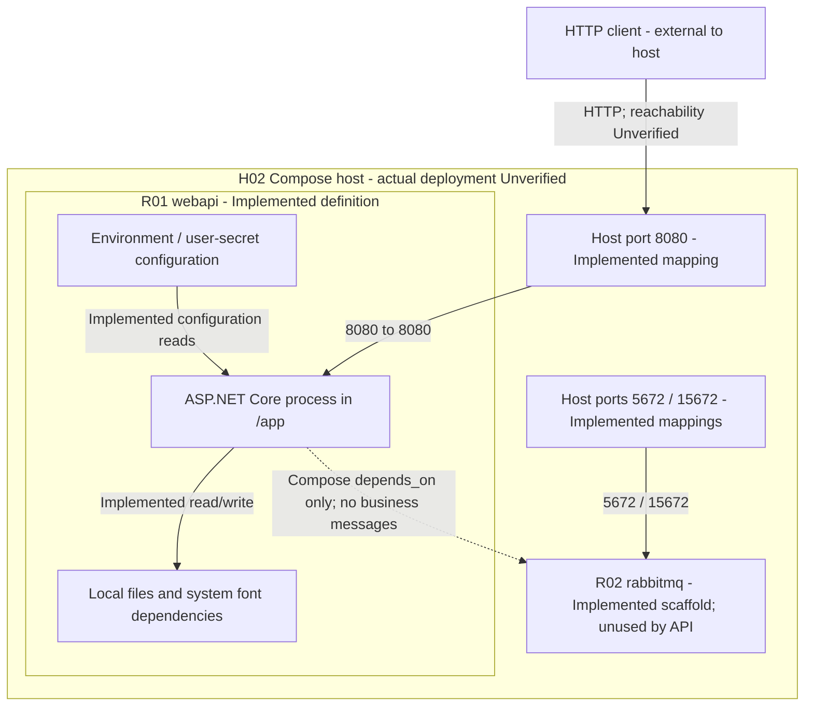

# Runtime, storage, and deployment view

[Architecture model](architecture-model.md) · [Deployment runbook](deployment.md)

## Runtime catalog

| ID | Element / status | Parent and execution boundary |
| --- | --- | --- |
| R01 | ASP.NET Core API / Implemented source | In S01. One process hosts controllers, MediatR, rendering, file I/O and optional Drive adapter. Successful start is unverified. |
| R02 | RabbitMQ / Implemented Compose scaffold | Separate service in the supplied Compose topology. No application producer, consumer or broker call. Running instance is unverified. |
| H01 | Local development host / Unverified actual runtime | Launch profile defines local URLs; no live process verified. |
| H02 | Compose host / Unverified actual runtime | Dockerfile/Compose describe a candidate deployment. No host identity or built/running image verified. |
| H03 | Production environment / Unverified | No provider, host, ingress, persistent volume or topology is established. Excluded from the configured-topology diagram. |

`H01` and `H02` are alternative deployment views of `R01`, not proof of two running
environments. Components are not independent containers. The Dockerfile's SDK build
stage is a build-time process; it is not present as an application service in the
final runtime image.

## Supplied Compose topology

The file/font dependency box is a logical requirement, not a declared Docker
volume. No volumes or font/output-directory provisioning are defined. No host
port 8081 mapping exists, although the Dockerfile exposes it as metadata. There is
no configured TLS certificate or proxy. Port exposure is not proof of reachability.

## Entrances, configuration, and outbound boundaries

| Boundary | Source declaration | Status / implication |
| --- | --- | --- |
| H01 → R01 HTTP(S) | Local launch profile: HTTPS 8078, HTTP 8079; Development; Swagger launch page. | Implemented profile, actual listeners/certificate unverified. |
| H02 → R01 HTTP | Compose publishes `8080:8080`; sets Development. | Implemented mapping, successful HTTP/redirect behavior unverified. |
| H02 → R02 broker/admin | Compose publishes 5672/15672 and guest credentials. | Implemented scaffold; no API use; network restrictions unverified. |
| R01 → filesystem | Relative template/output/credential paths; `/app` for container command. | Implemented calls; required files, fonts and permissions unverified. |
| R01 → configuration | Custom user-secrets then environment providers; separate web-host configuration. | Implemented; appsettings JSON does not feed the custom settings/logger object. |
| R01 → E01 | Google client OAuth/Drive operations, optional adapter path. | Implemented call sites; external connection/identity unverified. |

## Resource catalog

Each resource below has an **Implemented** source reference or access path. Its
existence at a deployment is separate: only D01 is a committed runtime input.

| ID | Resource / location | Producers, consumers and retention |
| --- | --- | --- |
| D01 | Template, `Input Files/Ticket.png` | Committed input; C05 reads it. Runtime/publish placement must be verified. |
| D02 | System Arial font | Host-provided dependency resolved by C05; installation is unverified. |
| D03 | `Output Files/ticket_<number>.png` | C05 creates, reads/embeds and deletes; shared filenames can collide. |
| D04 | `Output Files/<guid>.docx` and its in-memory bytes | C05 writes; C06 reads whole file; C08 attempts deletion; C02 returns buffered bytes. |
| D05 | Client's `Tickets.docx` | C02 sends download; A01 saves/opens externally. Server cannot control client retention. |
| D06 | User secrets / environment configuration | Supplied by operator; C12/C13 read custom settings; host also has its own config. Actual values unverified. |
| D07 | `client_secrets.json` | Optional C11 credential loader input. Actual credential provisioning unverified. |
| D08 | `token.json/` credential-cache directory | Optional Google authorization flow reads/writes; not a ticket-output file. |
| D09 | Configured log sink, example `Logs/Logs.txt` | C13 configures logging; components emit messages. Active sink and retention unverified. |

There is no persistent application database or job queue. Temporary artifacts are
not durable job records. D03/D04 cleanup does not guarantee deletion on all failures.
No filesystem sandbox, shared-volume coordination or at-rest encryption is defined
by the application. See [data and rendering](data-and-rendering.md).

## Trust and deployment interpretation

HTTP callers cross into R01 without an implemented endpoint authentication
requirement. R01 then exercises its process filesystem permissions. Enabling E01
adds a separate Google-account authorization boundary with full Drive scope and
local token storage. Optional R02 has its own network/admin surface; it is not a
security or resilience layer for ticket generation. No trust is conferred by
`UseAuthorization()` alone. See [security](security.md).

Sources: [Program](../../src/TicketMapper.WebApi/Program.cs),
[launch profile](../../src/TicketMapper.WebApi/Properties/launchSettings.json),
[Dockerfile](../../src/Dockerfile), [Compose](../../docker-compose.yml),
[configuration guide](configuration.md), [renderer](../../src/TicketMapper.Application/Commands/CreateDocumentCommand.cs).
