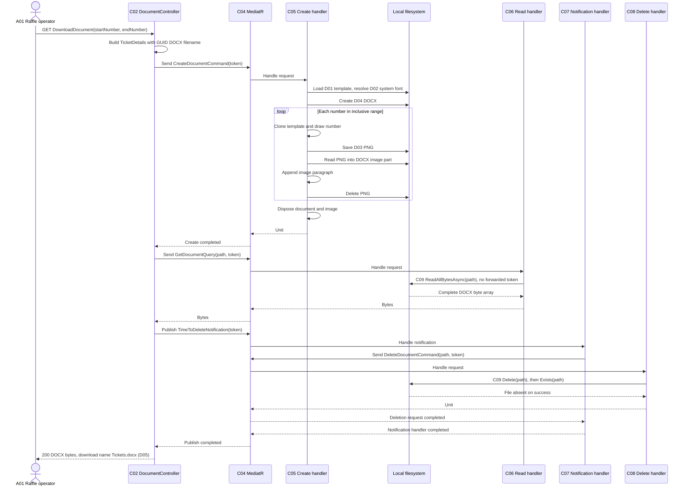
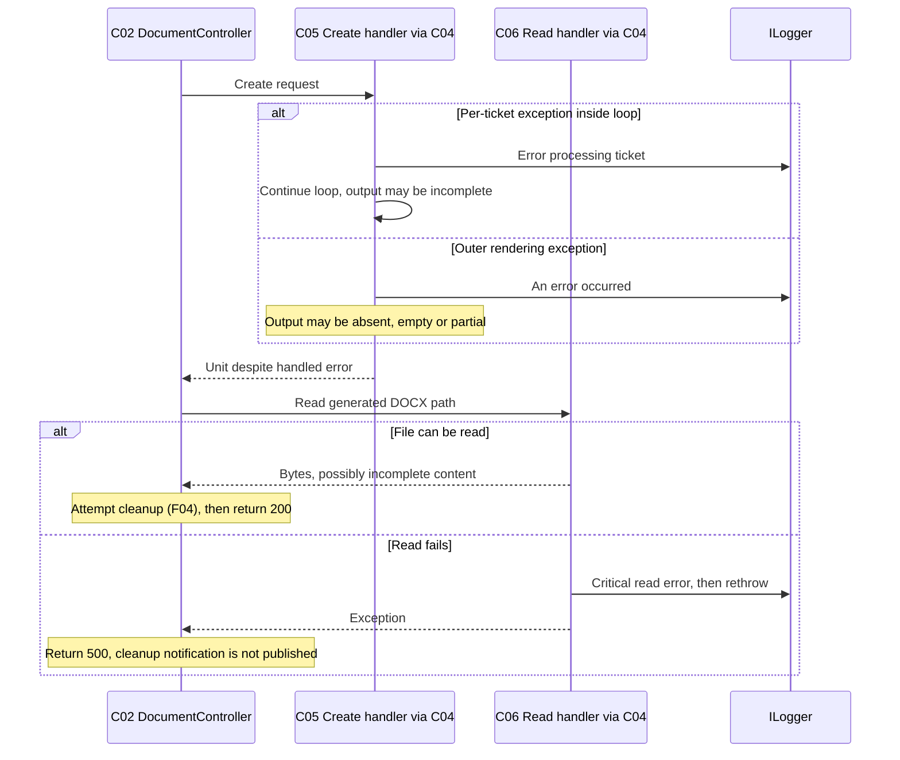
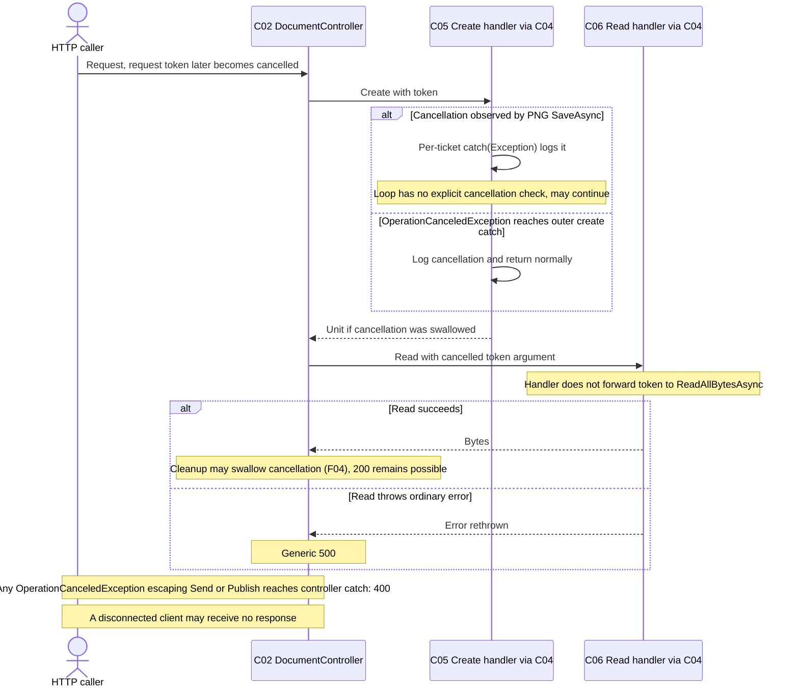
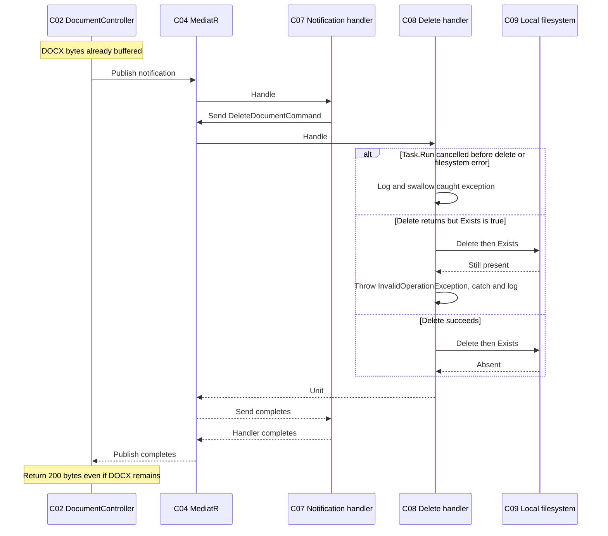

# Request sequence flows

[Architecture model](architecture-model.md) · [Component map](component-map.md)

All diagrams describe **Implemented source control flow**, not executed traces.
They assume successful build, DI resolution and required local assets. See
[known issues](known-issues.md) for why a live run has not been established.
Solid arrows are calls; dashed arrows are returns. Library/file operations remain
inside R01 except for the HTTP client. No sequence uses RabbitMQ or Google Drive.

## F01: successful generation and cleanup (UC01)

The controller awaits notification completion before constructing its file result.
Deletion is after buffering, not after transmission or client acknowledgement.
Neither `Unit` nor completion of `Publish` proves every ticket rendered or every
file was deleted. The controller does not generate a durable job or ticket ledger.

## F02: rendering/read failure alternatives (UC01)

An exception that escapes the initial `Send` rather than being handled by C05
(for example a dispatch/resolution failure) reaches the controller's first catch:
generic exceptions produce 500 with the generation-specific message. This is a
different path from swallowed rendering errors followed by a failed read. See
[API](api.md) for exact response text; the controller has no implemented 404 branch.

## F03: cancellation alternatives (UC01)

This diagram shows alternative paths, not guaranteed timing. An async method's
cancellation-token parameter alone does not guarantee prompt stopping. C08 passes
the token to `Task.Run`; once scheduled, the synchronous delete operation does not
observe that token. C07/C08 can swallow cancellation before it reaches C02.

## F04: cleanup failure or cancellation after a successful read (UC01)

C08 validates a blank path before its try/catch. An error escaping C08 or dispatch
is caught/logged by C07 in the normal notification path. A failure escaping
`Publish` itself can still trigger C02's second catch (400 for cancellation,
otherwise 500). PNGs left by C05 errors are not handled by the DOCX deletion command.
There is no retry queue, transaction or guaranteed `finally` cleanup.

## Sources and validation boundary

- [DocumentController](../../src/TicketMapper.WebApi/Controllers/DocumentController.cs): order, awaiting and response catches.
- [Create handler](../../src/TicketMapper.Application/Commands/CreateDocumentCommand.cs): rendering, per-ticket/outer catches and token use.
- [Read handler](../../src/TicketMapper.Application/Queries/GetDocumentQuery.cs): full buffering, rethrows and absent token forwarding.
- [Notification handler](../../src/TicketMapper.Application/IntegrationEventHandlers/TimeToDeleteNotificationHandler.cs): nested mediator call and catches.
- [Delete handler](../../src/TicketMapper.Application/Commands/DeleteDocumentCommand.cs): pre-try validation, Task.Run and swallowed failure.

The existing tests cover only portions of these handlers and have the limitations
in [development](development.md). Full flow, cancellation and failure tests remain
unverified; do not treat diagrams as test evidence.
